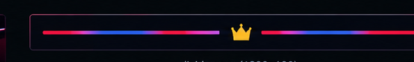

# 🎪 Willkommen bei **ErrorHunter**

**Developer · Selfhosting · Gaming · Pomni / The Amazing Digital Circus**

---

## 👾 Über mich

Ich entwickle Software, probiere neue Technologien aus und arbeite an eigenen Projekten. Außerdem interessiere ich mich für Server, Netzwerke, Gaming und **Pomni aus *The Amazing Digital Circus*.**

  
  
  
  

## 🚀 Projekte

| Projekt | Beschreibung |
|---|---|
| 🌐 [ErrorHunter Website](https://errorhunter.de) | Meine Website |
| 💻 [GitHub-Repositories](https://github.com/ErrorHunter?tab=repositories) | Meine öffentlichen Projekte |
| 🐳 [Docker-Projekte](https://github.com/ErrorHunter?tab=repositories&q=docker) | Projekte rund um Docker und Selfhosting |
| 🤖 [Bot-Projekte](https://github.com/ErrorHunter?tab=repositories&q=bot) | Bots und Automatisierungen |

## 🛠️ Technologien

  

## 📊 GitHub-Statistiken

  
  
  

## 🎭 Pomni

  
   
  <em>Ein bisschen Chaos, ein bisschen Code und ganz viel Digital Circus.</em>

---

  
   
  **Danke fürs Vorbeischauen!** ❤️💙
   
  Made with ❤️ by ErrorHunter

